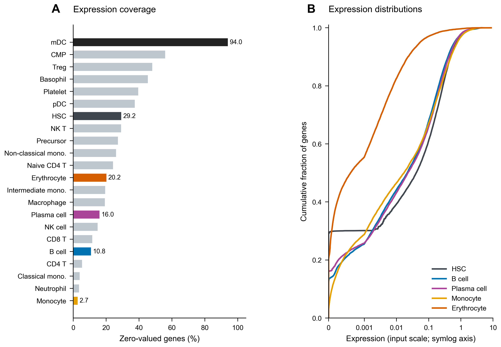
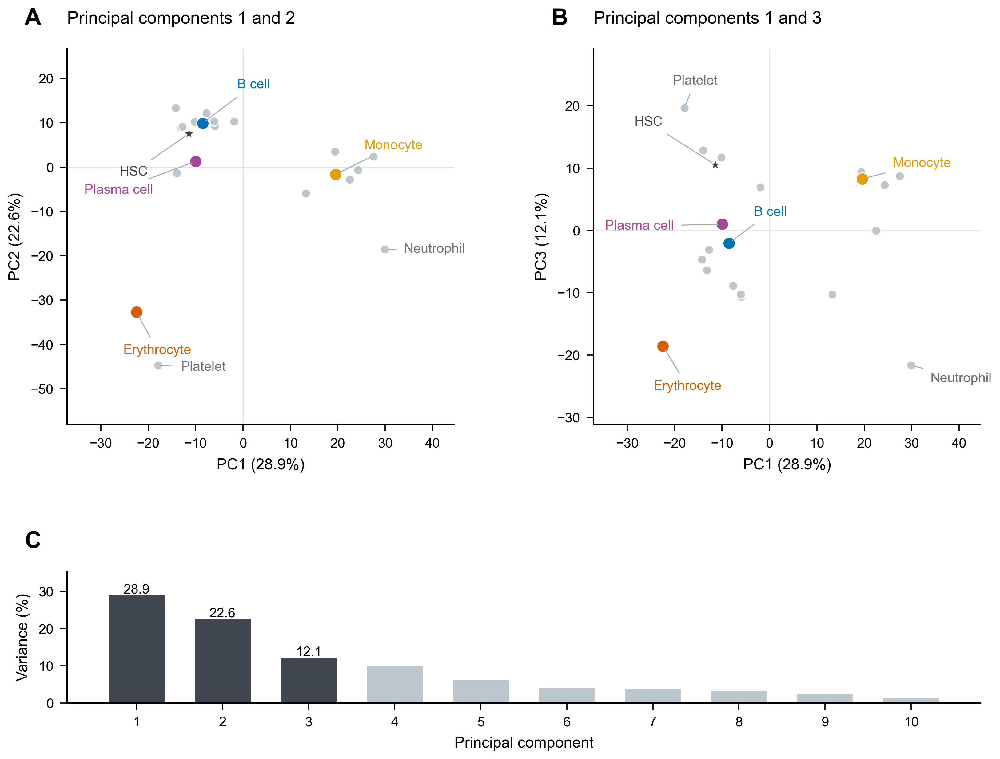
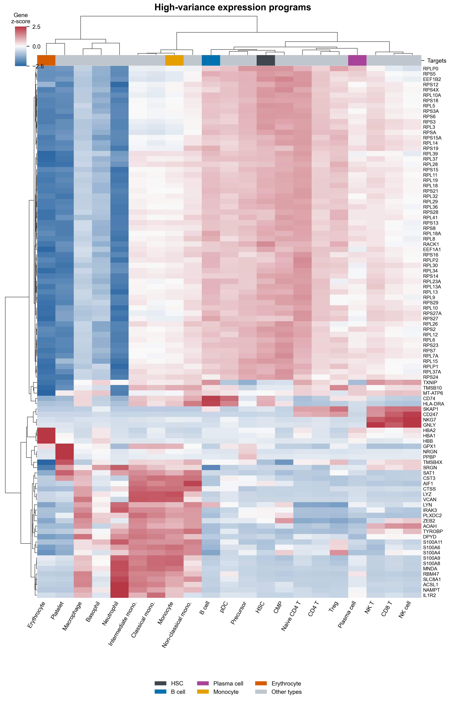
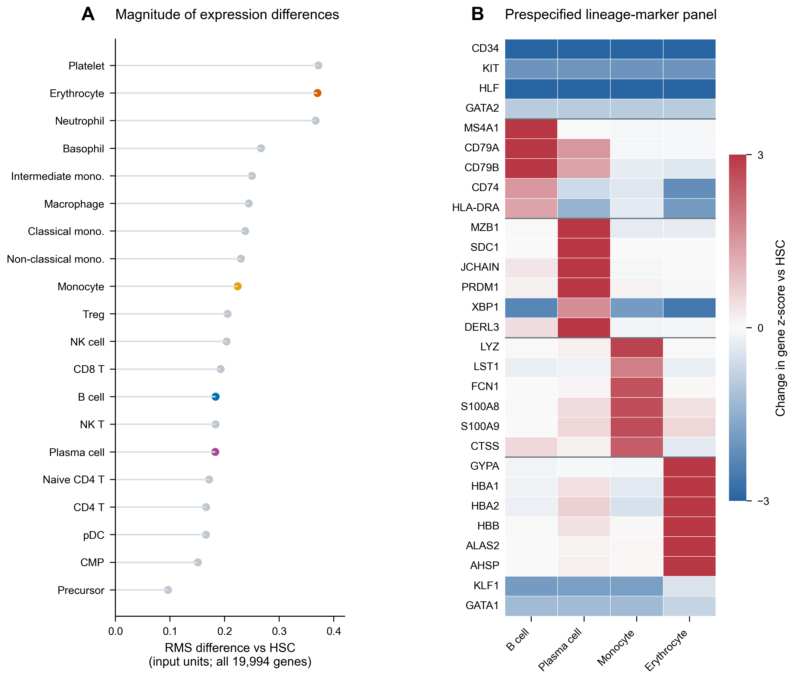

# 从造血干细胞到四类目标细胞：表达结构与分析尺度

第 2 阶段交付｜2026-11-07｜探索分析与图形样式

## 主要发现

血液平均表达谱呈现出清晰的细胞类型差异。以 1,000 个高变基因的逐基因标准化表达分析，前两个主成分解释 **51.54%** 的变异，前三个解释 **63.67%**。HSC 与造血前体细胞在欧氏距离和相关距离下都最接近。B 细胞与浆细胞相对 HSC 的整体差异幅度相近，同时表现出不同的参照基因模式；单核和红系表达谱提供了另外两种鲜明的目标状态。

这些结果支持继续采用已确定的四类重点目标，并为后续稀疏回归提供直观背景。表达结构的主要比较使用 1,000 个高变基因；100 基因热图承担细节展示。完整敏感性比较见下文。

## 数据范围与方法

输入沿用第 1 阶段冻结的 [HDF5 矩阵](../data/processed/analysis_matrices.h5)。探索分析使用 **19,994 个去重基因、22 类平均表达谱**；主分析纳入 HSC 和 20 个目标类型，共 21 类。髓系树突状细胞（mDC）的零值率为 94.00%，单列补充比较。后续回归使用的共同读出集合为 11,922 个基因，HSC 差异摘要同时保存这两个基因集合的结果。

高变基因按主分析 21 类细胞中的样本方差排序。热图使用前 100 个，PCA 和主聚类使用前 1,000 个；标准化采用每个基因在这 21 类细胞中的均值和样本标准差（ddof=1）。PCA 的观测点为细胞类型，变量为标准化基因表达。主聚类采用欧氏距离和 Ward 连接，对照采用 Pearson 相关距离和平均连接。

图中的表达差值、RMS 和零值比例描述输入平均表达谱；每种类型只有一列平均值，因此采用描述性比较。PCA 解释方差对应标准化后的特征空间。EDA 的基因筛选与标准化专用于本阶段展示，后续回归仍使用冻结的完整共同基因集合，并在训练折内拟合预处理。

## 表达分布与覆盖



**图 1｜** 左图为全部 22 类细胞的零值比例；右图为 HSC 与四个目标的跨基因累积分布。横轴采用 symlog 显示，数值保留输入尺度。HSC、B 细胞、浆细胞、单核和红细胞的零值比例分别为 29.21%、10.81%、15.96%、2.65% 和 20.15%。红细胞的表达分布集中于较低数值，同时保留少数高表达基因。mDC 的高零值率支持其作为附加筛查目标处理。

源数据：[逐类 QC](../tables/01_cell_quality.csv)、[完整 ECDF](../tables/02_focus_expression_ECDF.csv)。

## 表达结构：PCA、高变基因和聚类



**图 2｜** 1,000 个高变基因上的 PCA。A、B 分别显示 PC1–PC2 和 PC1–PC3，C 显示前十个主成分的解释方差。PC1、PC2、PC3 分别解释 28.93%、22.62%、12.12%。彩色点突出预先指定的重点目标，深灰星形为 HSC，浅灰点为其他类型。每个点对应一类平均表达谱。[全部坐标](../tables/02_PCA_coordinates.csv)提供完整身份。

HSC 的最近邻在两种距离下均为造血前体细胞：欧氏距离为 15.316，Pearson 相关为 0.791。这些数值计算于逐基因标准化的 HVG1000 表达谱。红细胞、血小板和中性粒细胞在 PCA 中占据相对独立的位置；单核相关类型聚集在邻近区域。轴的正负方向取决于分解约定，解释重点在于点之间的相对位置。



**图 3｜** 前 100 个高变基因的逐基因 z-score 热图。行、列树均由图中 100 基因矩阵按欧氏距离/Ward 法计算。色阶范围为 −2.5 至 2.5；完整数值保留于[源表](../tables/02_heatmap_HVG100_gene_zscores.csv)。该热图的列树与 HVG1000 主聚类使用各自的基因集合。

前 100 个高变基因中，**56 个具有 HGNC 核糖体相关 gene_group 注释**，另有 3 个属于所列 globin 基因集合。按名称前缀 `RP[SL]` 后接数字计数为 52；56 的统计采用 HGNC 分组注释。完整名单见 [HVG100 表](../tables/02_HVG_100.csv)。这说明方差最大的表达程序包含大量核糖体相关基因，100 基因热图提供了该结构的集中展示。

两种距离下的完整树见[聚类对照图 PDF](../figures/02_F5_clustering_comparison.pdf)。HSC—前体以及若干近邻关系保持一致，较高层级的合并顺序随距离定义改变。

## 四个目标相对 HSC 的表达差异



**图 4｜** A：20 个主要目标相对 HSC 的表达差值均方根（RMS），分母为全部 19,994 个基因。B：29 个预先选定的谱系参照基因，逐基因标准化后计算目标减 HSC 的差值；横线分隔 HSC/祖细胞、B、浆细胞、单核和红系参照组。色阶固定为 ±3，超出部分按端点色显示；[源表](../tables/02_marker_gene_zscore_HSC_difference.csv)保存全部数值。每个摘要对应一种细胞类型，图中采用无误差条的表达谱展示。

整体差异定义为 \(\mathrm{RMS}_t=\sqrt{G^{-1}\sum_g(E_{gt}-E_{g,\mathrm{HSC}})^2}\)。该指标描述目标与参考的表达距离；后续预测性能将使用独立的折外评价。

| 重点目标 | 相对 HSC 的 RMS（输入单位） | 参照面板中的主要正向变化 |
|---|---:|---|
| B 细胞 | 0.18356 | MS4A1、CD79A、CD79B |
| 浆细胞 | 0.18292 | SDC1、JCHAIN、MZB1、DERL3、PRDM1 |
| 单核细胞 | 0.22391 | LYZ、S100A9、S100A8、FCN1、CTSS |
| 红细胞 | 0.37004 | AHSP、ALAS2、HBB、GYPA、HBA1、HBA2 |

B 细胞和浆细胞的 RMS 接近，而两组参照基因分别突出不同表达特征。红系的高差异幅度同时包含广泛低表达背景与集中表达的红系基因。面板中 KLF1、GATA1 的目标减 HSC 数值为负，其表达时间窗和本数据的细胞注释背景将在候选文献讨论中结合分析。上述基因为展示用参照面板；后续候选排序由 Lasso 与稳定性分析产生。

原始差值见[四目标全基因差值](../tables/02_focus_HSC_differences.csv)；两种基因集合的 RMS 与平均绝对差值见[差异摘要](../tables/02_HSC_difference_summary.csv)。

## 对分析选择的敏感性

聚类对照固定比较 k=3–8，以 HVG1000、逐基因 z-score、欧氏距离/Ward 的分组为参考。调整兰德指数（ARI）为 1 表示分组完全一致；下表保留全部预定比较。

| 方法 | k=3 | k=4 | k=5 | k=6 | k=7 | k=8 |
|---|---:|---:|---:|---:|---:|---:|
| HVG1000，z-score，Ward（参考） | 1.000 | 1.000 | 1.000 | 1.000 | 1.000 | 1.000 |
| HVG500，z-score，Ward | 1.000 | 1.000 | 1.000 | 1.000 | 1.000 | 0.659 |
| HVG100，z-score，Ward | 0.822 | 0.870 | 0.475 | 0.512 | 0.533 | 0.493 |
| HVG1000，z-score，相关距离/平均连接 | 1.000 | 0.614 | 0.863 | 0.836 | 0.780 | 0.942 |
| HVG1000，输入尺度，Ward | 1.000 | 1.000 | 0.492 | 1.000 | 1.000 | 0.659 |

500 与 1,000 个基因在 k=3–7 时分组一致，k=8 时出现差异；100 基因的分组更依赖截树层级。距离与尺度对照也显示部分层级发生改变。因此整体结构优先依据 HVG1000 与完整对照解释，HVG100 热图用于观察最强变异程序。

完整图见[敏感性热图](../figures/02_S2_clustering_sensitivity.pdf)，对应[ARI 表](../tables/02_clustering_sensitivity.csv)与[全部分组](../tables/02_cluster_assignments.csv)。

mDC 的补充分析包含两种操作：固定主分析的基因、均值/标准差和 PCA 轴进行投影；纳入全部 22 类后重新选基因、标准化并拟合。两种视角见[mDC 对照图](../figures/02_S1_mDC_sensitivity.pdf)。重新拟合的 PC1、PC2 分别解释 25.31%、22.36%；两套坐标轴随输入数据重新确定。主分析继续采用已批准的 21 类型设计，mDC 的结果保留在补充材料中。

## 图形规范与交付

已生成 5 张主图和 2 张补充图，每图提供 PDF、SVG、450 dpi PNG，共 21 个文件。统一 Arial 字体、英文图内标签、中文图注；HSC 为深灰，B 细胞为蓝色，浆细胞为紫色，单核为橙黄色，红细胞为朱红色。主图字体约 7–9 pt，100 基因热图采用 5.8 pt 基因标签，适合独立整页展示。所有图形数据保存为 CSV，标准化与色阶设置见[图注文件](02_figure_captions.md)。

Prism 已载入四目标 RMS 数据，数值与源表核对一致。打开数据 XML 时出现格式提示，创建图形时界面超时；当前交付保留 [TSV 数据](../prism/HSC_difference_data.tsv)和 [Prism XML 数据](../prism/HSC_difference_data.pzfx)，Prism 原生图形、PDF/TIFF 导出待补。该状态见 [Prism 操作记录](../prism/README.md)。本阶段图形成果由上述完整脚本图组提供。

复现入口（课程根目录）：

```bash
sh HW2/solution/scripts/run_python.sh HW2/solution/scripts/eda_figures.py
sh HW2/solution/scripts/run_python.sh HW2/solution/scripts/verify_stage2.py
```

第 1 阶段矩阵及原始文件保持不变；本阶段使用本地计算，远端无新增任务。机器验收结果保存于 [stage2_validation.json](../logs/stage2_validation.json)，独立审核结论见 [审核意见](02_independent_review.md)。

## 本次审核重点

请审核统一配色和图形风格、四类目标的展示方式，以及将 Prism 原生样板留作后续补充的安排。第 3 阶段将在用户批准后开始：对全部 21 个非 HSC 目标完成 Lasso、均值基线、嵌套验证及单扰动相关排序。
