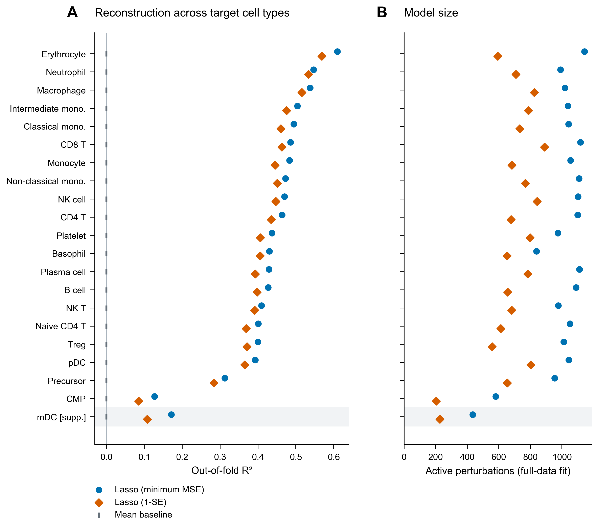
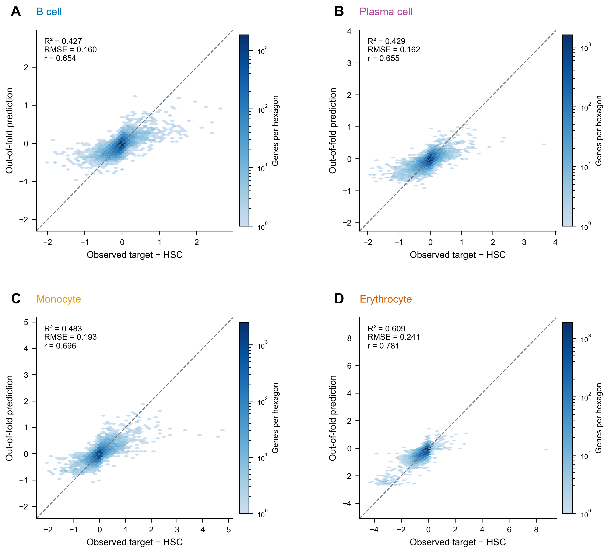
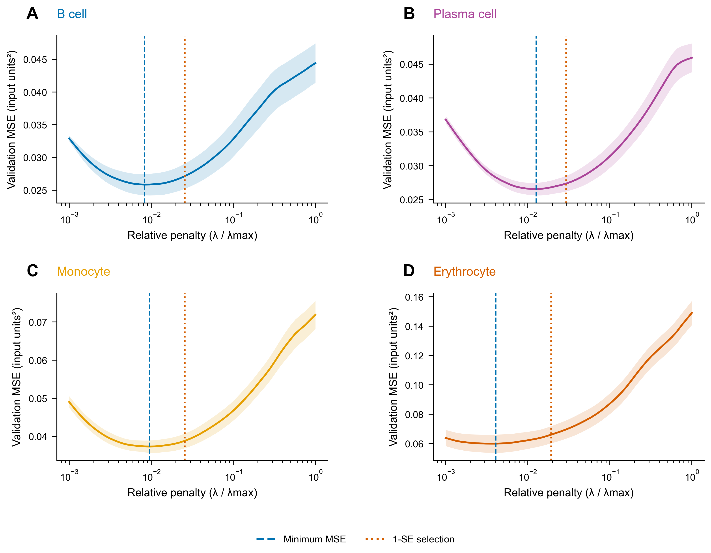
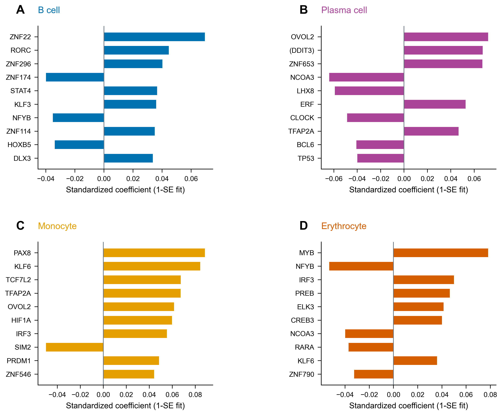

# L1000 扰动谱对血液细胞表达差异的重建：Lasso 主分析

第 3 阶段交付｜2026-11-07｜21 个目标、嵌套验证与候选初筛

## 主要结果

Lasso 在全部 21 个目标上均优于训练折均值基线。20 个主要目标的折外 R² 中位数为 **0.450**，范围为 **0.127–0.609**。四个重点目标中，B 细胞、浆细胞、单核细胞和红细胞的折外 R² 分别为 **0.427、0.429、0.483 和 0.609**；相对均值基线，RMSE 分别降低 **24.3%、24.4%、28.1% 和 37.5%**。

1-SE 模型在预测表现与模型大小之间提供了另一种选择：四目标的全数据活跃扰动数减少 **29.4%–48.1%**，对应折外 R² 为 0.393–0.568。本阶段同时交付两套模型、完整调参路径和带符号的 TF 初筛表，为下一步多模型及稳定性分析提供统一基准。

## 问题、数据与评价

响应为每个目标相对 HSC 的输入尺度表达差值，使用 **11,922 个共同基因、2,717 个 L1000 扰动**。每个目标独立拟合；20 个目标进入主比较，mDC 作为附加目标单列。

评价采用固定种子 20261107、外层五折与内层三折。全部目标共用基因划分。X 列标准化、y 标准化和 λmax 都在相应训练折内计算，50 个相对惩罚强度覆盖 λmax 至 0.001λmax。参数选择采用原尺度内层 MSE；每个基因的预测来自其所属外层测试折。完整方法、1-SE 定义和求解记录见[方法说明](03_lasso_methods.md)。

本报告的折外指标评价留出基因上的表达差异重建。全数据模型在嵌套评价之后独立重新调参，用于系数解释和候选排序。它的模型大小与折外指标在图表中分别标注。

## 全目标重建表现

**图 1｜** 左图比较合并外层测试预测的 R²；右图展示全数据最终模型的活跃扰动数。最低误差模型与 1-SE 模型分别使用蓝色圆点和朱红色菱形，均值基线用灰色短线表示。mDC 位于底部阴影区。活跃阈值为标准化系数绝对值大于 10⁻⁶。

在主要目标中，红细胞 R² 最高（0.609），其后为中性粒细胞（0.547）和巨噬细胞（0.538）。造血前体与共同髓系祖细胞分别为 0.312 和 0.127，呈现出不同的重建难度。mDC 的 R² 为 0.171；其 94.00% 的血液零值率与附加分析定位沿用前两阶段的处理。

全部 21 个目标、两套 Lasso 和基线的四项指标见[完整指标表](../tables/03_model_metrics.csv)。[每折指标](../tables/03_fold_metrics.csv)保留五个外层测试折的结果，供检查折间变化。

## 四类重点目标

| 目标 | 最低误差 R² | RMSE | Pearson r | Spearman ρ | 1-SE R² | 基线 RMSE |
|---|---:|---:|---:|---:|---:|---:|
| B 细胞 | 0.4271 | 0.1595 | 0.6540 | 0.6107 | 0.3974 | 0.2107 |
| 浆细胞 | 0.4289 | 0.1620 | 0.6555 | 0.5829 | 0.3929 | 0.2143 |
| 单核细胞 | 0.4835 | 0.1927 | 0.6960 | 0.6285 | 0.4448 | 0.2681 |
| 红细胞 | 0.6093 | 0.2413 | 0.7809 | 0.6953 | 0.5685 | 0.3861 |

RMSE 保留输入单位。各目标的表达变化范围不同，因此跨目标比较同时考察 R²、相关性和相对基线的误差改善。

**图 2｜** 四目标最低误差 Lasso 的全部 11,922 个基因折外预测。颜色表示六边形内基因数，对数色阶分别设置；虚线为 y=x。多数基因位于变化较小的密集区域，部分大幅变化基因的预测向中心收缩。该现象与正则化拟合的整体形态一并保留，后续可结合 landmark 读出与候选自身读出排除进行检视。

## 惩罚强度与简约模型

**图 3｜** 全数据最终模型的三折调参曲线。阴影为折均值 ±1 个标准误，蓝虚线为最低 MSE 选择，朱红点线为 1-SE 选择。每个内层折使用自身训练数据确定的 λmax，横轴统一为相对惩罚强度。该图解释候选模型的选择；预测评价使用前述独立外层测试结果。

| 目标 | 最低误差 λ/λmax | 1-SE λ/λmax | 最低误差活跃数 | 1-SE 活跃数 | 活跃数减少 |
|---|---:|---:|---:|---:|---:|
| B 细胞 | 0.008286 | 0.025595 | 1,089 | 656 | 39.8% |
| 浆细胞 | 0.012649 | 0.029471 | 1,111 | 784 | 29.4% |
| 单核细胞 | 0.009541 | 0.025595 | 1,054 | 683 | 35.2% |
| 红细胞 | 0.004095 | 0.019307 | 1,142 | 593 | 48.1% |

全部目标的外层及全数据参数选择均位于搜索路径的最弱惩罚边界之内，没有选中 0.001λmax 这一端点。四目标 1-SE 模型保留了数百个活跃扰动，说明该字典下的重建依赖较广的组合；下一阶段将进一步比较相关变量的替代关系和重复抽样中的选择表现。

图 4 的[系数路径](../figures/03_F4_coefficient_paths.pdf)显示各目标 1-SE 模型中幅度最大的 12 个扰动如何随惩罚改变。完整 2,717 条路径保存在各目标的 `model_arrays.npz` 中。全部相对/绝对惩罚、模型大小和边界标记见[选择记录](../tables/03_selected_models.csv)。

## TF 初筛与单扰动参照

**图 5｜** 每目标展示全数据 1-SE 模型中至多 10 个 TF，按标准化系数绝对值排序并保留符号。TF 资格沿用冻结注释，括号等原始扰动标签保持完整。

| 目标 | 初筛表中幅度较大的正向 TF | 初筛表中的负向 TF 举例 |
|---|---|---|
| B 细胞 | ZNF22、RORC、ZNF296 | ZNF174、NFYB、HOXB5 |
| 浆细胞 | OVOL2、(DDIT3)、ZNF653 | NCOA3、LHX8、CLOCK、BCL6 |
| 单核细胞 | PAX8、KLF6、TCF7L2、TFAP2A | SIM2 |
| 红细胞 | MYB、IRF3、PREB | NFYB、NCOA3、RARA |

这些系数描述各扰动表达模式在联合重建中的条件方向。红细胞的 MYB、浆细胞的 BCL6，以及单核细胞的 KLF6、PRDM1 为后续文献与稳健性分析提供了具体切入点。B 细胞的前列 TF 主要为 ZNF22、RORC 等；可用扰动 EBF1 在该目标的 1-SE 模型中系数为零。不同目标保留各自的数据排序，机制解释将在后续结合血液细胞背景、MCF7 扰动来源与文献展开。

本阶段同时保留全扰动和 TF 两套表：[全部系数及注释](../tables/03_all_coefficients_annotated.csv)、[全部活跃 TF](../tables/03_TF_candidates_all.csv)、[四目标前 10 个 TF](../tables/03_focus_TF_top10_1se.csv)。表中的外层五次选择比例描述五个相关训练集合中的出现情况；预定的 100 次子抽样稳定性分析在第 4 阶段执行。

单扰动排序覆盖全部 **57,057 个目标–扰动组合**，同时保存 Pearson、Spearman、正向排序与绝对相关排序。四目标中绝对 Pearson 最高的扰动分别为 MAPK14（B 细胞，0.209）、QDPR（浆细胞，0.132）、KLF6（单核，0.187）、DHH（红细胞，0.322）。该排序是全数据内的边际关联参照，可与联合模型的条件系数并列阅读。完整结果见[相关排序表](../tables/03_single_perturbation_correlations_annotated.csv)。

## 数值核验与成果保存

正式计算使用四张 A100 上的双精度批量 Lasso 路径：24 个训练上下文 ×21 个独立目标 ×50 个惩罚强度，共 **25,200 个路径拟合**。首个真实上下文用时 54.35 秒，其余上下文的四卡并行部分用时 274.25 秒；依赖准备、结果汇总与传输另计。每个拟合均保存原始/对偶目标、对偶间隙与迭代数。用于调参和最终预测的 **20,160 条拟合记录**全部收敛，未触发延长迭代。

独立数值交叉核验采用 scikit-learn Lasso 冷启动、10⁻⁸ 的更严格阈值，重新拟合 B 细胞的两套最终参数。与 GPU 解相比，预测 RMS 差异为 6.53×10⁻⁵ 和 6.08×10⁻⁵ 个输入单位，目标函数差异均小于 5×10⁻⁸。活跃数在该严格参考中分别为 1,083 和 655；与正式 10⁻⁴ 阈值结果的差异集中于接近零的系数。正式表格统一采用配置中的求解精度与 10⁻⁶ 活跃阈值，后续稳定性分析继续保留这些设置和数值检查。

本地验收从原始训练/验证行重算内层误差、外层预测、指标、标准化、λmax、1-SE 选择及选定模型的对偶证书；结果见[验收记录](../logs/stage3_validation.json)。另外，远端清单中的 **245 个文件**已按相对路径、字节数和 SHA-256 与本地逐项核验一致，见[同步验收](../logs/stage3_remote_archive_validation.json)。派生计算缓存可由保存的输入与程序重新生成。

5 组图均提供 PDF、SVG 和 450 dpi PNG，中文图注见[图注文件](03_figure_captions.md)。每目标目录位于 `results/lasso/target_00` 至 `target_20`，包含基因级折外预测、调参曲线、选定模型、路径、系数、收敛与指标。完整 GPU 路径和证书位于 `results/lasso_gpu_paths`。代码、依赖和工作日志均已保存本地。

## 解释范围与下一步

本阶段使用细胞类型平均表达谱和 MCF7 过表达扰动字典，结论对应这两个数据空间之间的基因表达重建。L1000 读出包含直接测量与推断基因，随机基因留出的表现由这一共同基因空间决定。第 4 阶段将通过多模型、landmark 子集、标准化尺度、自身读出排除和重采样，进一步检视预测与候选在不同条件下的表现。

独立 subagent 已完成审核，结论为“可交付，无阻断问题，无需重算主结果”。审核独立重建划分、复算指标与候选排序，并从原始训练矩阵抽查 480 个对偶证书；两项复现与文档问题均已修复。完整意见见[阶段 3 独立审核](03_independent_review.md)。用户审核通过后进入第 4 阶段；Prism 原生样板按已批准安排后续补充。实例仍用于后续已规划任务，本阶段完成后继续保留。
