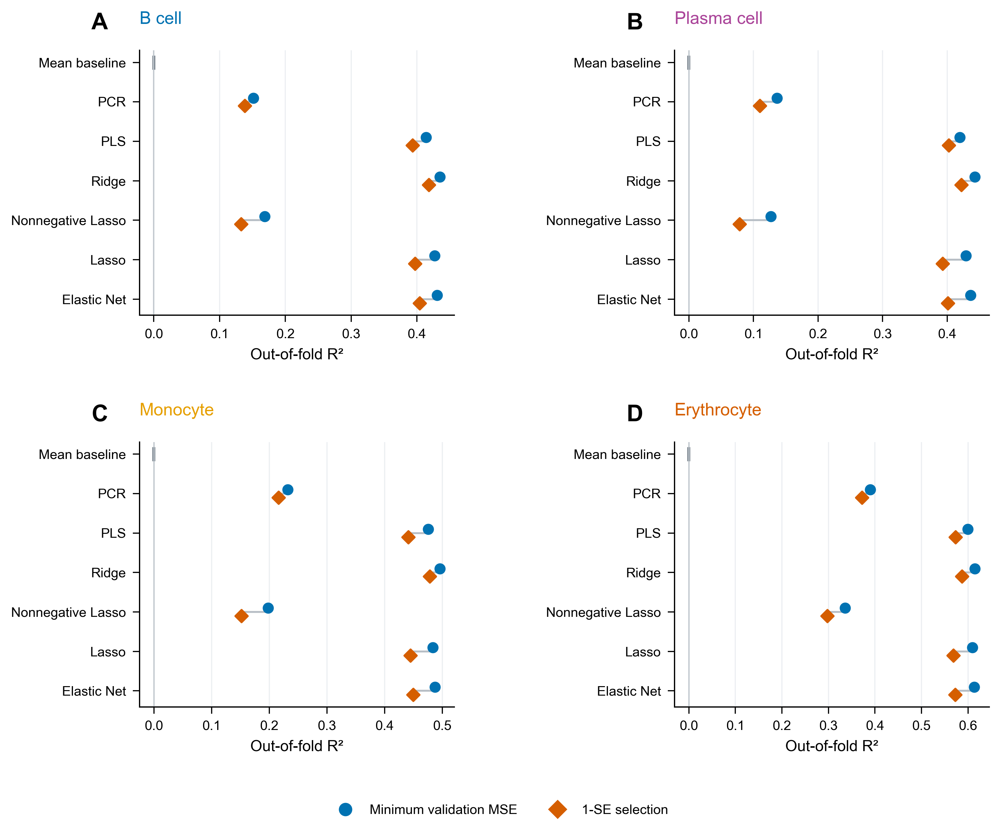
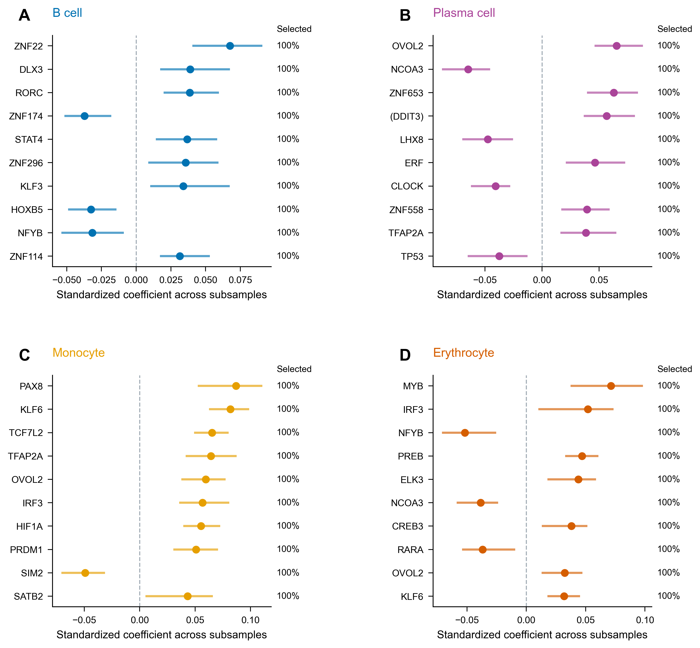
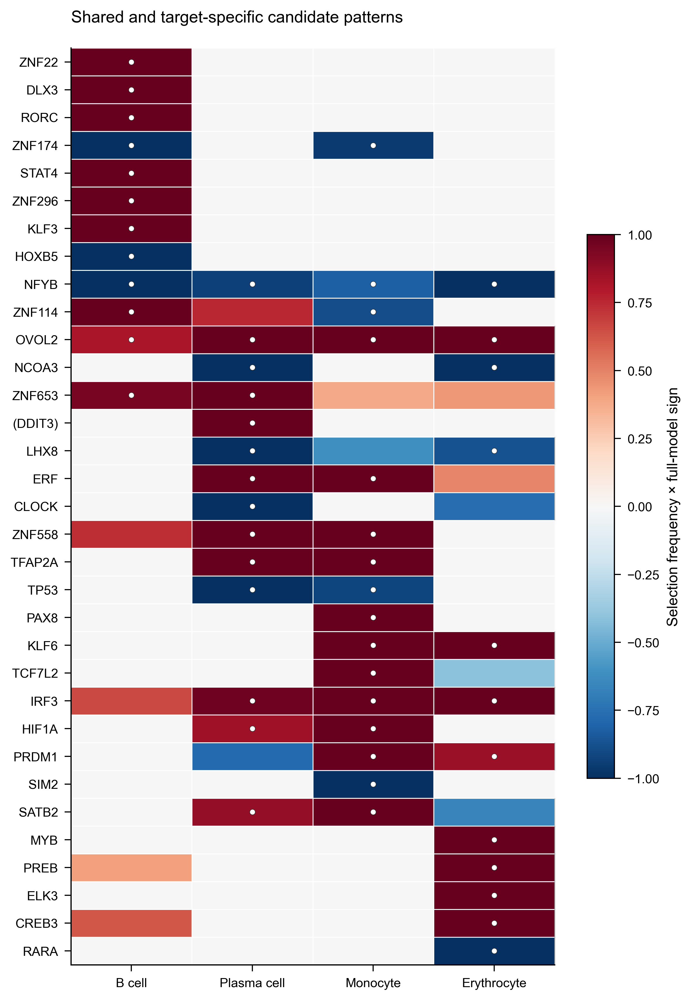
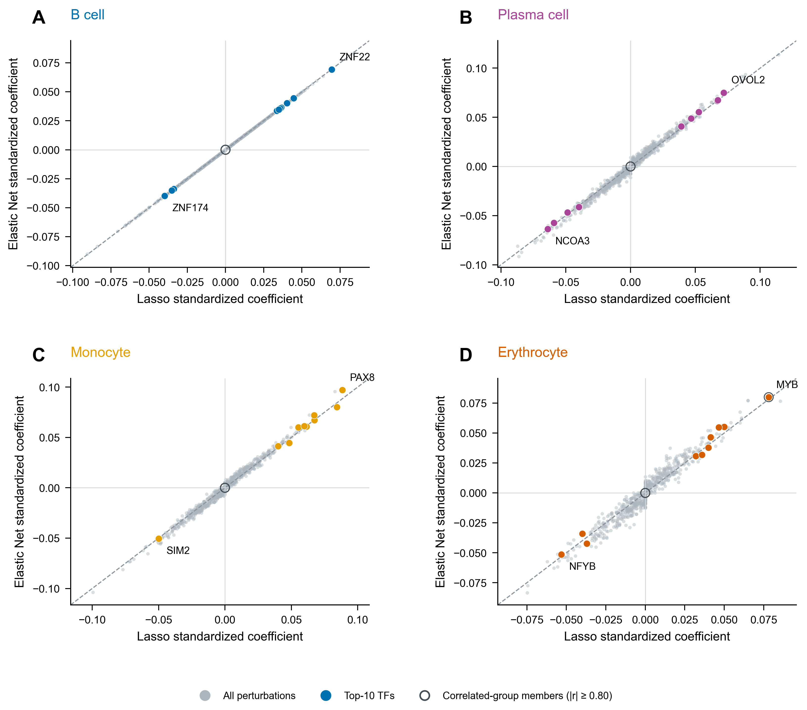
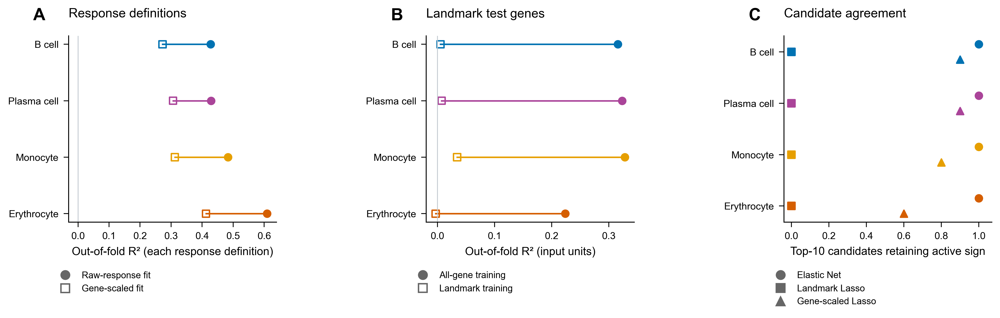
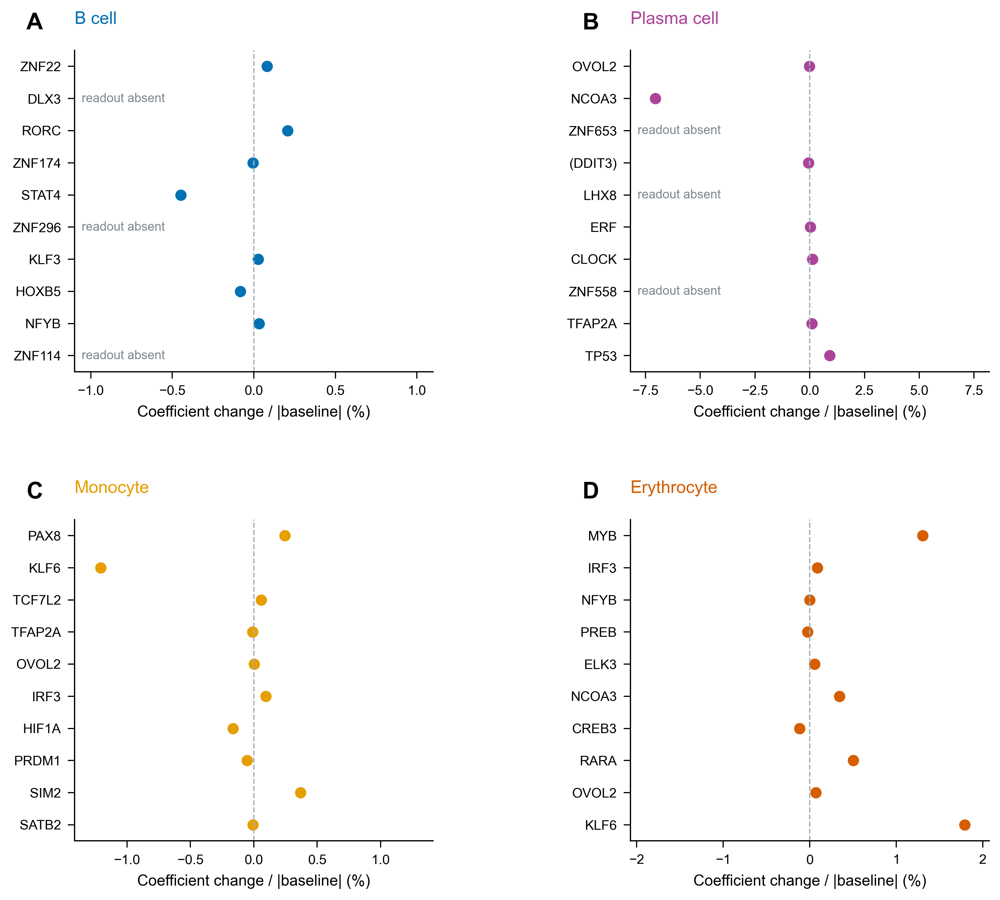
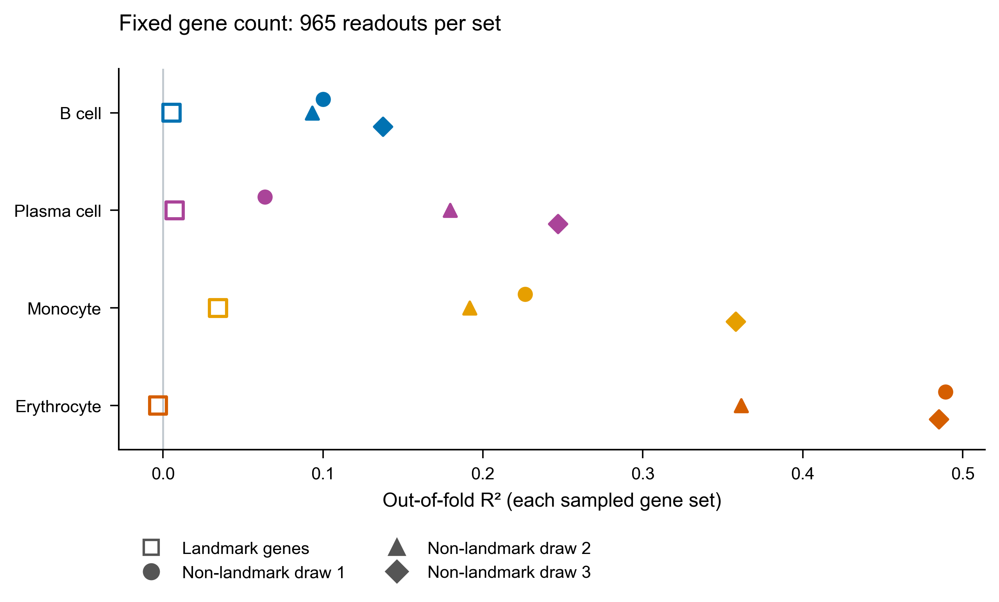

# 血液细胞表达重建的模型结构与 TF 稳健性

第 4 阶段交付｜2026-11-07｜四类目标、六类统计模型、100 次子抽样与敏感性分析

## 主要发现

共享外层测试基因的比较显示，B 细胞为 Ridge（R²=0.435）；浆细胞为 Ridge（R²=0.443）；单核细胞为 Ridge（R²=0.496）；红细胞为 Ridge（R²=0.615）。Ridge 相对 Lasso 的 R² 增量为 0.0055–0.0139；Elastic Net 在四个目标上也提供了较高的重建表现。所有六类模型均按预定范围完成调参，最低误差与 1-SE 两套结果完整保留。

100 次 80% 基因子抽样得到的稳定优先 TF 扰动条目数，B、浆、单核、红细胞分别为 **41, 43, 52, 42**。候选排序同时保留选择频率、系数方向与幅度。直接测量基因、响应尺度和自身读出检查进一步展示各候选在不同分析条件下的表现。

## 共享测试基因上的模型比较

| 模型 | B 细胞 | 浆细胞 | 单核细胞 | 红细胞 |
|---|---|---|---|---|
| 均值基线 | -0.0000 | -0.0002 | -0.0002 | -0.0001 |
| Lasso | 0.4271 | 0.4289 | 0.4835 | 0.6093 |
| Elastic Net | 0.4309 | 0.4359 | 0.4874 | 0.6134 |
| Ridge | 0.4350 | 0.4429 | 0.4958 | 0.6148 |
| PCR | 0.1513 | 0.1362 | 0.2319 | 0.3897 |
| PLS | 0.4142 | 0.4195 | 0.4756 | 0.5992 |
| 非负 Lasso | 0.1686 | 0.1269 | 0.1979 | 0.3357 |

表中为合并五个外层测试折的 R²，模型参数由各自内层三折最低 MSE 决定。完整 RMSE、Pearson、Spearman、1-SE 结果和逐折指标见[主指标表](../tables/04_model_metrics.csv)与[分折指标](../tables/04_fold_metrics.csv)。

**图 1｜** 全部六类模型与均值基线；两种参数选择共用测试基因。各模型的表示方式提供不同的组合约束：Lasso 与 Elastic Net产生稀疏系数，Ridge 保留连续收缩的组合，PCR 和 PLS 使用低维表示，非负 Lasso 约束组合系数方向。

四目标的 PCR 与 PLS 最低误差全数据模型都达到预定成分上限，分别为 100 和 20 个成分。本轮比较对应这一预先设定的搜索范围；全部参数选择列于后文。

## 从初筛走向可重复选择的候选

| 目标 | 稳定优先 TF 扰动条目 | 规范 TF 身份数 | 排名前五：方向、选择频率 |
|---|---|---|---|
| B 细胞 | 41 | 41 | ZNF22 (+, 100%); DLX3 (+, 100%); RORC (+, 100%); ZNF174 (−, 100%); STAT4 (+, 100%) |
| 浆细胞 | 43 | 43 | OVOL2 (+, 100%); NCOA3 (−, 100%); ZNF653 (+, 100%); (DDIT3) (+, 100%); LHX8 (−, 100%) |
| 单核细胞 | 52 | 52 | PAX8 (+, 100%); KLF6 (+, 100%); TCF7L2 (+, 100%); TFAP2A (+, 100%); OVOL2 (+, 100%) |
| 红细胞 | 42 | 42 | MYB (+, 100%); IRF3 (+, 100%); NFYB (−, 100%); PREB (+, 100%); ELK3 (+, 100%) |

稳定优先规则为选择频率至少 80%、活跃抽样中的多数符号一致性至少 90%，并在全数据 1-SE 模型中活跃。四目标共享 100 个抽样集合，每次 9,537 个基因；相对惩罚固定为第 3 阶段的 1-SE 选择，各次重新计算训练尺度与 λmax，并从零系数独立初始化。排序按频率、幅度中位数及全数据幅度依次确定。

**图 2｜** 每目标展示至多 10 个 TF。点与分位线呈现 100 次系数分布，右侧数字为选择频率；彩色圆点满足稳定优先规则。完整候选和分布见[全部 TF 稳定性](../tables/04_stability_all_TFs.csv)、[稳定优先 TF](../tables/04_stable_priority_TFs.csv)与[前 10 项](../tables/04_top10_TF_candidates.csv)。

系数方向描述扰动表达模式在联合重建中的条件贡献。每个候选的身份、模型表现和敏感性证据汇入[候选证据矩阵](../tables/04_candidate_evidence_matrix.csv)，供下一阶段逐项查证文献。

## 跨目标共同模式与相关扰动

四目标共同出现的稳定 TF 规范身份共 **2** 个，依字母顺序包括：NFYB、OVOL2。全部两两交集与 Jaccard 见[重叠表](../tables/04_stable_TF_overlap.csv)。

**图 3｜** 四组前 10 个候选的并集，颜色结合方向和选择频率，白点标记稳定优先项。图中保留原始扰动标签，集合重叠按规范基因身份计算。

相关组以扰动谱绝对 Pearson 相关阈值构建连接，并取连通分量。阈值对照如下：

| 绝对相关阈值 | 全部连通组 | 多成员组 | 最大组成员数 |
|---|---|---|---|
| 0.7 | 2628 | 9 | 80 |
| 0.8 | 2711 | 2 | 6 |
| 0.9 | 2717 | 0 | 1 |

**图 4｜** Lasso 与 Elastic Net 的全部系数对照，突出前 10 个 TF 和 0.80 阈值下的相关组成员。完整[组成员](../tables/04_correlation_groups.csv)、[组预测贡献与活跃数](../tables/04_group_model_comparison.csv)和[候选相关伙伴](../tables/04_candidate_correlated_partners.csv)用于追踪相关变量的替代与共同贡献。

主要阈值下得到两个多成员组。MYB 与 HSP90AB1、POLB、DHH、RPS6KB2、PPP3CB 位于同一连通组；在红细胞的 Lasso 与 Elastic Net 1-SE 模型中，该组六个成员里均由 MYB 保持活跃，组预测贡献标准差分别约为 0.0782 和 0.0800（标准化响应单位）。NFYB 与 OVOL2 则是四目标共同的稳定 TF 身份，分别呈一致的负向与正向重建贡献。

## 读出与响应尺度的敏感性

| 目标 | 原差值任务：全部基因 | 标准化差值任务：全部基因 | 原模型：landmark 测试基因 | landmark 训练与测试 |
|---|---|---|---|---|
| B 细胞 | 0.4271 | 0.2725 | 0.3160 | 0.0053 |
| 浆细胞 | 0.4289 | 0.3065 | 0.3236 | 0.0073 |
| 单核细胞 | 0.4835 | 0.3122 | 0.3281 | 0.0344 |
| 红细胞 | 0.6093 | 0.4126 | 0.2240 | -0.0031 |

前两列使用全部 11,922 个相同留出基因，分别评价原差值和逐基因标准化差值两个响应定义；后两列在原差值任务中使用相同的 965 个 landmark 测试读出。模型主排名保持原差值任务的评价口径。全部敏感性指标见[敏感性指标表](../tables/04_sensitivity_metrics.csv)。

**图 5｜** 比较响应权重、训练读出和候选方向。逐基因标准化强调细胞类型之间的相对表达模式；landmark 专项分析集中于官方直接测量的读出。各模型的系数交集、方向一致率与全系数排序相关见[候选集合比较](../tables/04_candidate_set_agreement.csv)。

前 10 个候选的逐项表现如下：

landmark 专项的四个全数据 1-SE 模型均选择了仅含截距的简约解，因此其候选同向活跃数为零。该结果与对应的训练基因数量和读出组成一并考察。

| 目标 | Elastic Net 同向活跃 | landmark 同向活跃 | 逐基因标准化同向活跃 | 自身读出删除后同向活跃 | 删除后最大系数相对变化 |
|---|---|---|---|---|---|
| B 细胞 | 10/10 | 0/10 | 9/10 | 7/7 | 0.45% |
| 浆细胞 | 10/10 | 0/10 | 9/10 | 7/7 | 7.05% |
| 单核细胞 | 10/10 | 0/10 | 8/10 | 10/10 | 1.21% |
| 红细胞 | 10/10 | 0/10 | 6/10 | 10/10 | 1.79% |

四组前 10 个候选在 Elastic Net 中均保留活跃方向；逐基因标准化响应下分别保留 9、9、8、6 个。这些交叉证据可用于安排后续文献精读；原定稳定性排序完整保留。

## 候选自身读出检查

按规范身份匹配后，34 个目标—候选条目完成自身读出删除检查，6 个条目在共同读出集合中没有自身基因。共享同一规范身份的删除任务合并执行。

**图 6｜** 删除匹配读出后，重新计算训练尺度与 λmax 并拟合固定相对惩罚。完整基线和删除模型均采用 10⁻⁶ 的更严格对偶阈值，图示相对系数变化。逐项匹配、系数方向、边际相关变化与证书见[自身读出结果](../tables/04_self_readout_results.csv)。

## 固定读出数量的补充对照

将三组非 landmark 读出分别抽至 965 个，每组重新完成 Lasso 的外层五折、内层三折调参，得到以下最低误差模型结果：

| 目标 | landmark | 非 landmark 抽样 1 | 非 landmark 抽样 2 | 非 landmark 抽样 3 |
|---|---|---|---|---|
| B 细胞 | 0.0053 | 0.1000 | 0.0932 | 0.1374 |
| 浆细胞 | 0.0073 | 0.0638 | 0.1794 | 0.2469 |
| 单核细胞 | 0.0344 | 0.2264 | 0.1917 | 0.3579 |
| 红细胞 | -0.0031 | 0.4893 | 0.3615 | 0.4851 |

在相同总基因数下，三组非 landmark 集合的四目标 R² 均高于 landmark 专项结果，提示基因组成对本任务表现具有实质影响。结合全基因训练模型在共同 landmark 测试读出上的结果，可以从读出组成与训练覆盖两个角度理解这项敏感性。

**图 7｜** 固定读出总数后的组成敏感性。每个外层测试折的数量与 landmark 集合精确匹配，内层训练与验证名单通过原划分求交确定，内层数量随抽样变化。各组训练和测试基因身份同时改变，因此分数描述同样本量下的不同读出集合。三次抽样呈现本轮抽样范围，相关结果用于补充解释，主模型排名仍以全部共同基因为依据。

完整[补充指标](../tables/04_size_control_metrics.csv)、[逐基因预测](../tables/04_size_control_predictions.csv)、[参数选择](../tables/04_size_control_choices.csv)和[调参曲线](../tables/04_size_control_tuning.csv)均已保存。

## 参数、数值验收与复现

| 目标 | 模型 | 最低误差参数 | 1-SE 参数 | 1-SE 活跃系数数 |
|---|---|---|---|---|
| B 细胞 | Elastic Net | 相对惩罚 0.00720，ρ=0.1 | 相对惩罚 0.02560，ρ=0.9 | 656 |
| B 细胞 | Ridge | λ=0.1 | λ=0.31623 | 2717 |
| B 细胞 | PCR | 100 个成分 | 50 个成分 | 2716 |
| B 细胞 | PLS | 20 个成分 | 20 个成分 | 2717 |
| B 细胞 | 非负 Lasso | 相对惩罚 0.03393 | 相对惩罚 0.21210 | 52 |
| 浆细胞 | Elastic Net | 相对惩罚 0.00954，ρ=0.1 | 相对惩罚 0.02560，ρ=0.9 | 836 |
| 浆细胞 | Ridge | λ=0.1 | λ=0.1 | 2717 |
| 浆细胞 | PCR | 100 个成分 | 100 个成分 | 2717 |
| 浆细胞 | PLS | 20 个成分 | 20 个成分 | 2717 |
| 浆细胞 | 非负 Lasso | 相对惩罚 0.05179 | 相对惩罚 0.24421 | 84 |
| 单核细胞 | Elastic Net | 相对惩罚 0.00720，ρ=0.1 | 相对惩罚 0.02223，ρ=0.9 | 730 |
| 单核细胞 | Ridge | λ=0.1 | λ=0.31623 | 2717 |
| 单核细胞 | PCR | 100 个成分 | 100 个成分 | 2716 |
| 单核细胞 | PLS | 20 个成分 | 20 个成分 | 2717 |
| 单核细胞 | 非负 Lasso | 相对惩罚 0.03907 | 相对惩罚 0.15999 | 87 |
| 红细胞 | Elastic Net | 相对惩罚 0.00309，ρ=0.1 | 相对惩罚 0.01456，ρ=0.9 | 700 |
| 红细胞 | Ridge | λ=0.031623 | λ=0.31623 | 2716 |
| 红细胞 | PCR | 100 个成分 | 100 个成分 | 2716 |
| 红细胞 | PLS | 20 个成分 | 20 个成分 | 2717 |
| 红细胞 | 非负 Lasso | 相对惩罚 0.02560 | 相对惩罚 0.10481 | 90 |

稠密表示模型的活跃系数数与成分数分别描述原扰动空间和低维表示。所有内层误差曲线、完整模型选择及双模型系数均已保存，见[参数选择](../tables/04_selected_models.csv)、[调参曲线](../tables/04_tuning_curves.csv)和[全部系数](../tables/04_all_coefficients_annotated.csv)。

初始模型、敏感性和重采样试算批次的四卡运行用时 18.76 分钟（复用首个独立试点）；正式从零初始化的 100 次重采样补充批次用时 27.74 秒。自身读出批次用时 15.12 秒。初始化试算与正式结果的对照另存于[初始化敏感性表](../tables/04_initialization_sensitivity.csv)。环境准备、汇总、传输、制图与验收时间单独记录。新增模型的 17 项独立 CPU 参考均通过；从原始训练行进行的 9 项验收也全部通过。详细记录见[CPU 参考](../logs/stage4_solver_crosscheck.json)与[阶段验收](../logs/stage4_validation.json)。补充对照另有[原始行验收记录](../logs/stage4_size_control_validation.json)，覆盖三次抽样、60 个训练上下文、全部参数选择和预测。

统计定义、数值算法、固定种子、敏感性口径及来源见[方法说明](04_methods.md)。7 组图均导出 PDF、SVG 和 450 dpi PNG，中文说明见[图注](04_figure_captions.md)。分析程序、处理数据、每次抽样索引、预测、系数、图表、环境与日志均归档本地。

## 证据范围与下一阶段

本阶段的稳定性对应当前 MCF7 扰动字典、平均血液表达谱和固定相对惩罚下的基因子抽样。landmark 与尺度对照展示读出范围和误差权重改变时的结果。下一阶段将围绕这些具体候选，结合血液细胞调控机制、编辑验证与递送背景组织文献证据，并形成可独立使用的核心 Markdown 报告。

独立审核意见见[第 4 阶段审核](04_independent_review.md)。本阶段完成后暂停供用户审核；第 5 阶段等待批准。Prism 原生样板继续按已批准安排后续补充。
