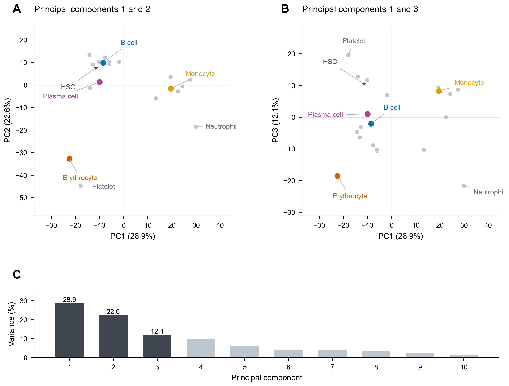
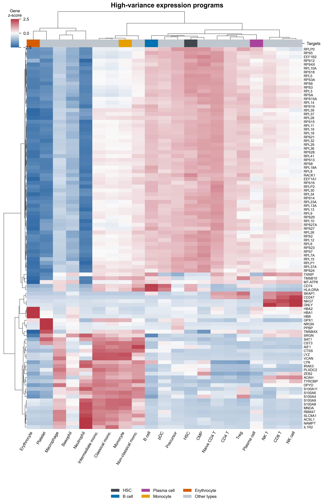
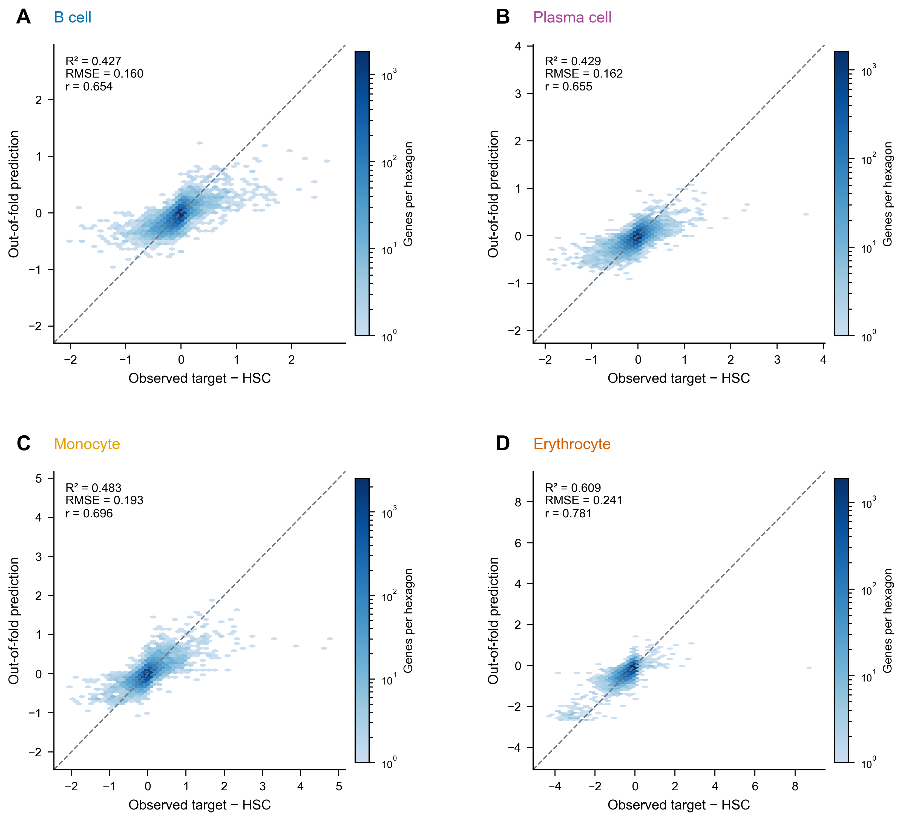
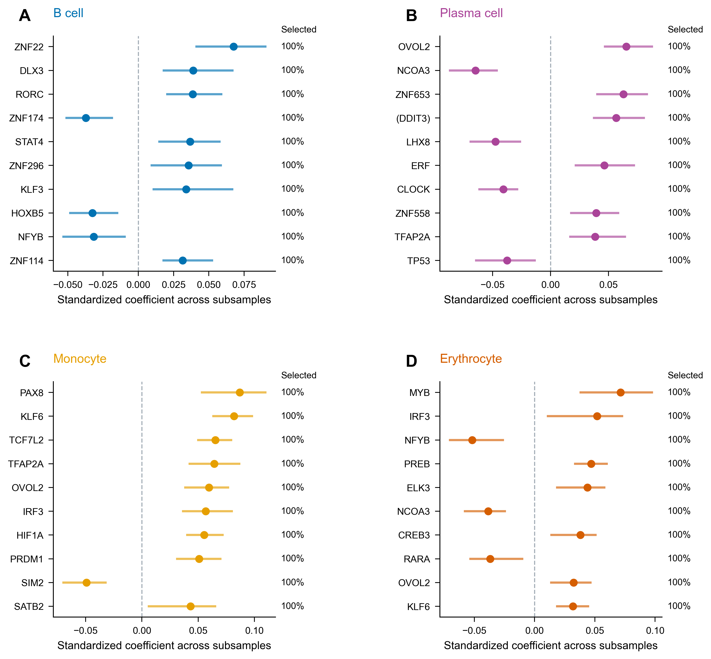

# 血液细胞表达差异的 Lasso 重建与转录因子候选分析

## 摘要

不同血液细胞的功能差异伴随着不同的基因表达程序。本研究以造血干细胞（HSC）为参考，将目标细胞的表达差值与 L1000 过表达扰动谱进行匹配，筛选能够共同重建目标模式的转录因子（TF）候选。对 11,922 个共同基因和 2,717 个扰动建立 Lasso 模型，在 21 个非 HSC 类型中进行筛查，重点讨论 B 细胞、浆细胞、单核细胞和红细胞。四目标留出基因上的 R² 分别为 **0.427、0.429、0.483、0.609**，红细胞表现最佳。100 次基因子抽样得到 41、43、52、42 个稳定优先 TF 条目。文献支持将红系 MYB、浆细胞负向 BCL6、单核细胞 KLF6／PRDM1 作为重点解释对象；ZNF22 等统计前列候选提供进一步研究线索。研究形成了从表达模式匹配、重复选择到机制解释的候选优先级，可为细胞背景明确的干预验证和后续扰动预测提供起点。

## 1．研究问题与数据

研究问题是：**哪些 L1000 扰动的表达变化模式，与目标血液细胞相对于 HSC 的表达差异相匹配？** 血液平均表达谱给出目标模式，L1000 提供已观测的扰动模式，回归模型估计各模式在联合重建中的权重。候选 TF 的价值来自统计匹配与相关生物学证据的结合。

作业提供 `bloodmeanexpr.csv` 和 `L1000MCF7_OEgeneexpression.h5`。后者为 MCF7 背景的过表达扰动字典。L1000 平台直接测量一组 landmark 基因，并推断更广的转录组读出；本研究使用课程给定矩阵，并通过官方注释识别其中的直接测量基因。[R01：Subramanian A，2017](https://pubmed.ncbi.nlm.nih.gov/29195078/)

| 数据检查 | 结果与处理 |
|---|---|
| 血液矩阵 | 原 20,001 行、22 类平均谱；重复基因保留首条后为 19,994 个基因 |
| L1000 矩阵 | 原 12,328 行、2,717 个扰动；去重后为 12,327 个基因 |
| 基因对齐 | 按原始符号精确匹配，共 11,940 个；去除血液全部类型中均为零的 18 个，最终 11,922 个 |
| 缺失与数值 | 冻结输入均为有限值；血液表达保留输入尺度，L1000 保留正负扰动分数 |
| TF 与直接测量读出 | 291 个 TF 扰动条目、290 个规范身份；共同基因中 965 个为 landmark |
| 类型范围 | 所有 21 个非 HSC 类型均建模；零值率 94.00% 的髓系树突状细胞（mDC）单列附加结果 |

TF 资格依据 Human TFs 目录，并以 HGNC 核对身份。不同构建体保留原标签，例如 `DDIT3` 和 `(DDIT3)` 为独立模型列；跨目标集合比较采用规范基因身份。[R02：Lambert SA，2018](https://pubmed.ncbi.nlm.nih.gov/29425488/)

## 2．表达结构与模型方法

探索分析使用 HSC 和 20 个主要目标的平均表达谱。按跨细胞类型方差选择高变基因，逐基因标准化；前 100 个用于热图，前 1,000 个用于 PCA 和聚类。主聚类采用欧氏距离和 Ward 连接，并以相关距离作对照。PCA 前两个主成分解释 **51.54%** 的变异，HSC 与造血前体在两种距离下均最接近。

**图 1｜血液细胞表达结构。** 每个点代表一类平均表达谱，重点目标使用统一颜色。A、B 展示前两个及第一／第三主成分，C 为解释方差。图中基因筛选与标准化用于探索展示，回归使用完整共同基因并在训练折内预处理。

**图 2｜前 100 个高变基因的表达模式。** 行为基因，列为细胞类型，颜色为逐基因 z-score。树由图示矩阵的欧氏距离与 Ward 方法生成。该集合中 56 个基因带有核糖体相关分组注释，提示较强的跨类型变异同时包含共同细胞功能程序。

目标相对 HSC 的参照表达变化具有不同特征：B 细胞突出 MS4A1、CD79A、CD79B；浆细胞突出 JCHAIN、MZB1、SDC1；单核细胞突出 LYZ、S100A8、S100A9；红细胞突出 HBB、HBA1、HBA2、ALAS2。这些来自当前矩阵的观察构成回归解释的背景。

对每个目标定义：

\[
y_g=E_{g,\mathrm{target}}-E_{g,\mathrm{HSC}},\qquad
y_g\approx\beta_0+\sum_{p=1}^{2717}X_{gp}\beta_p.
\]

这里每一行是一个基因，每一列是一个扰动的表达模式。Lasso 通过 L1 惩罚筛选贡献模式，目标函数为平方误差的一半加系数绝对值惩罚。正、负系数分别表示该模式在联合组合中的同向和反向贡献。

评价采用固定种子 20261107、外层五折与内层三折。训练折内拟合 X／y 的均值与尺度、确定正则化路径；预测回到原响应单位后评价。内层比较 50 个相对惩罚强度，由 λmax 至 0.001λmax。最低误差参数用于预测表现；全数据独立调参后采用 1-SE 规则选择更简约的候选模型。每个基因均有一次外层留出预测，主要报告 R²、RMSE、Pearson 和 Spearman 相关。

四目标进一步各做 100 次无放回 80% 基因子抽样，每次 9,537 个基因，固定全数据 1-SE 相对惩罚并重新计算训练尺度、λmax，从零系数拟合。选择频率至少 80%、活跃抽样中符号一致性至少 90%、全数据系数非零的 TF 记为稳定优先候选；排序依次依据频率、系数幅度中位数和全数据幅度。

## 3．主要结果：可重建的表达差异与目标特异候选

### 3.1 红细胞表达差异的重建表现最好

全部 21 个目标的 Lasso 均优于训练折均值预测。20 个主要目标的 R² 中位数为 0.450，范围为 0.127–0.609；红细胞为最高，其后为中性粒细胞和巨噬细胞。重点结果如下。

| 目标 | Lasso R² | Pearson r | RMSE | 相对均值基线 RMSE 降低 | 稳定优先 TF 条目 |
|---|---|---|---|---|---|
| B 细胞 | 0.427 | 0.654 | 0.1595 | 24.3% | 41 |
| 浆细胞 | 0.429 | 0.655 | 0.1620 | 24.4% | 43 |
| 单核细胞 | 0.483 | 0.696 | 0.1927 | 28.1% | 52 |
| 红细胞 | 0.609 | 0.781 | 0.2413 | 37.5% | 42 |

R² 评价被留出基因上的表达差异重建。红细胞的 R²=0.609，说明当前字典能捕获其较大部分表达差异结构。四目标相对均值基线的 RMSE 降低 24.3%–37.5%，支持进一步利用模型开展候选分析。

**图 3｜四目标的留出基因预测。** 横、纵轴分别为观测与预测表达差值，六边形颜色表示基因数，虚线为完全一致。多数基因接近低变化区，大幅变化的预测存在向中心收缩。每个点的预测均来自未使用该基因训练的外层模型。

### 3.2 候选具有重复选择性，也体现细胞类型差异

四目标分别得到 41、43、52、42 个稳定优先 TF 条目。B 细胞与浆细胞共有 7 个稳定规范身份，Jaccard=0.091；四类目标共同出现的稳定身份为 **NFYB 和 OVOL2**。这表明同一扰动字典可以同时识别共享模式与目标相关模式。

**图 4｜每目标前 10 个 TF 的条件稳定性。** 点与分位线呈现 100 次系数分布，右侧标注选择频率；方向与全数据候选保持明确对应。图示前 10 项均在 100 次抽样中被选中，完整排序和各项敏感性保存在源表。分位线描述本次子抽样分布。

为使生物学讨论集中，选择下面的代表案例。统计排序保持原值；BCL6 位于浆细胞第 15 名，因其直接机制证据而列入讨论，图 4 的前 10 项展示范围保持不变。

| 目标 | 代表 TF | 本目标 TF 稳定性名次 | 系数方向 | 抽样选择频率 | 讨论定位 |
|---|---|---|---|---|---|
| 红细胞 | MYB | 1 | 正 | 100% | 红系机制支持 |
| 浆细胞 | BCL6 | 15 | 负 | 100% | 浆细胞机制支持 |
| 单核细胞 | KLF6 | 2 | 正 | 100% | 邻近髓系背景支持 |
| 单核细胞 | PRDM1 | 8 | 正 | 100% | 邻近髓系背景支持 |
| B 细胞 | ZNF22 | 1 | 正 | 100% | 本次定向检索尚未定位直接证据 |
| 浆细胞 | OVOL2 | 1 | 正 | 100% | 共同模式候选 |
| 红细胞 | NFYB | 3 | 负 | 100% | 共同模式候选 |

### 3.3 模型与读出对照支持怎样的解释

Ridge 在四目标的 R² 为 0.435、0.443、0.496、0.615，较 Lasso 增加 0.0055–0.0139；Elastic Net 的结果也接近 Lasso。本报告以 Lasso 的表达重建和候选解释为主线，全部六类模型的原定比较见附录。

前 10 个 TF 在 Elastic Net 中均保留活跃方向。删除候选自身表达读出后，34 个可匹配条目仍保留方向，最大系数相对变化为 7.05%；其余 6 项缺少自身读出。该检查支持这些候选的联合贡献由更广的表达模式承载。

读出选择对结果有实质影响：仅用 965 个 landmark 基因重新训练，四目标 R² 为 0.005、0.007、0.034、−0.003；使用全部基因训练，再在相同 landmark 留出读出上评价，则为 0.316、0.324、0.328、0.224。三组等数量非 landmark 对照的表现均高于 landmark 专项结果，提示训练覆盖与读出组成需要共同考察。逐基因标准化也会改变候选集合，相关结果完整保留在附录中。

## 4．生物学解释：从匹配模式到可检验的机制

### 4.1 红系 MYB：与发育程序相呼应的统计首位候选

MYB 为红细胞的第 1 位 TF，系数为正，100 次抽样均被选中。Bianchi 等在人 CD34+ 造血细胞中研究了 MYB 下调，提出其通过 KLF1 和 LMO2 参与红系与巨核系命运选择；这一证据为当前红系匹配提供了较直接的机制联系。[R03：Bianchi E，2010](https://pubmed.ncbi.nlm.nih.gov/20686118/)

进一步的红系研究显示，c-Myb 参与谱系承诺、向红细胞母细胞阶段推进及终末细胞分裂，其作用具有发育阶段特点。因此，本结果最适合被解释为 **MYB 相关表达程序与红系差异相匹配**，后续验证应关注目标细胞所处阶段与表达持续时间。[R04：Vegiopoulos A，2006](https://pubmed.ncbi.nlm.nih.gov/16484593/)

### 4.2 B／浆细胞：BCL6 的方向线索与 ZNF22 的探索价值

浆细胞模型中 BCL6 为负向稳定候选，选择频率 100%。Tunyaplin 等发现 Bcl-6 可以直接结合并抑制 Prdm1，小鼠 Bcl6 缺失后浆细胞发育加快。当前负向匹配与解除 BCL6 对浆细胞程序的抑制这一方向相呼应，是连接统计系数与分化机制的清晰案例。[R05：Tunyaplin C，2004](https://pubmed.ncbi.nlm.nih.gov/15240705/)

B 细胞统计首位为 ZNF22。此次围绕 ZNF22 与 B 细胞、淋巴细胞和造血的定向检索尚未定位直接机制研究，因此将它保留为探索候选。作为参照，EBF1 有小鼠 B 细胞发育的遗传证据，但在当前 B 细胞全数据模型中系数为零。两者提示候选匹配同时受可用扰动背景、目标状态和联合变量组合影响；下一步可将 ZNF22 与 EBF1 这一已知参照共同放到 B 细胞背景中检验。[R08：Lin H，1995](https://pubmed.ncbi.nlm.nih.gov/7542362/)

### 4.3 单核细胞：KLF6 与 PRDM1 指向髓系功能状态

单核细胞中 KLF6 和 PRDM1 分列第 2 和第 8 位，均为正向、100% 选择频率。Date 等在人和小鼠巨噬细胞体系中支持 KLF6 参与炎症极化和相关转录调控，为它与髓系表达模式的联系提供了实验基础。[R06：Date D，2014](https://pubmed.ncbi.nlm.nih.gov/24385430/)

后续研究提出巨噬细胞中的 KLF6–PRDM1–BCL6 调控轴。这使两个候选共同出现具有可检验的机制线索：优先考察它们是否反映髓系炎症功能状态，再检验这种状态与当前单核细胞平均谱之间的联系。该文献证据来自巨噬细胞背景，本研究没有直接估计三者之间的调控边。[R07：Kim GD，2016](https://pubmed.ncbi.nlm.nih.gov/27539853/)

### 4.4 共享候选用于区分共同状态与谱系特征

NFYB 在四目标中均呈负向稳定贡献，OVOL2 均呈正向稳定贡献。本数据的高变基因又包含大量核糖体相关基因，因此可以提出一个后续假设：跨目标共享候选可能部分反映共同的生长、代谢或状态变化程序。该假设需要在独立数据中通过表达模块和细胞状态读出检验。当前保留它们的原始统计排序，并与 MYB、KLF6 等具有具体背景证据的候选分别讨论。

## 5．后续验证与科研连接

### 5.1 先检验候选，再扩展模型

后续验证采用三个连续问题：候选能否在独立血液数据中重现；在合适细胞背景中改变候选后，是否出现预测方向的表达程序；这种变化是否伴随预期的细胞状态或功能变化。分析层面优先使用含供体信息的数据，按供体评价重复性，并对阶段、增殖和应激状态作分层。

实验设计可首先聚焦红系 MYB、B／浆细胞 BCL6 和探索候选 ZNF22、髓系 KLF6／PRDM1。分别在相关发育或功能背景中比较方向明确的调节，设置非靶向和已知谱系参照，结合独立生物重复、单细胞转录组及谱系／功能读出。基因编辑与短期表达调节可帮助区分持续调控和暂时响应；具体干预方向由候选自身的机制证据和背景验证共同确定。

### 5.2 与基因编辑和递送研究的联系

血液系统已有通过调控元件编辑改变红系输出的实例：Frangoul 等报道在人自体造血干／祖细胞中编辑 BCL11A 的红系增强子，以提高胎儿血红蛋白。该研究说明，转录调控研究可以从候选 TF 进一步落到细胞特异调控元件与功能输出。[R09：Frangoul H，2021](https://pubmed.ncbi.nlm.nih.gov/33283989/)

Breda 等研究了靶向 HSC 的 mRNA 脂质纳米颗粒递送，为在体调节造血细胞提供了实验研究方向。结合本作业，递送方向最值得关注的变量是细胞靶向性、表达持续时间和干预后状态分布；对阶段依赖的调控因子，这些因素应与候选身份共同评价。本作业的候选表可用于提出研究问题，具体应用需在对应模型中验证。[R10：Breda L，2023](https://pubmed.ncbi.nlm.nih.gov/37499029/)

### 5.3 与基础模型、扰动预测和医学世界模型的联系

本研究已有一套可解释的表达模式匹配基线。面向基础模型，下一层问题是：模型能否利用细胞状态和干预信息预测新的表达响应？Norman 等的单细胞组合扰动研究提供了这一类数据；GEARS 将基因关系图与扰动响应预测结合，scGPT 和 scFoundation 则从大规模细胞数据学习表示。[R11：Norman TM，2019](https://pubmed.ncbi.nlm.nih.gov/31395745/)；[R12：Roohani Y，2024](https://pubmed.ncbi.nlm.nih.gov/37592036/)；[R13：Cui H，2024](https://pubmed.ncbi.nlm.nih.gov/38409223/)；[R14：Hao M，2024](https://pubmed.ncbi.nlm.nih.gov/38844628/)

近期研究强调评价设计的重要性。2025 年 Ahlmann-Eltze 等在所测试任务中发现简单基线具有很强竞争力；2026 年 TxPert 工作进一步结合多种关系图，并强调匹配批次对照与扰动身份检索评价。两项工作共同提示，研究重点应放在清楚定义新干预／新背景的泛化问题、保持有力基线，以及检验模型是否抓住干预特异信号。[R15：Ahlmann-Eltze C，2025](https://www.nature.com/articles/s41592-025-02772-6)；[R16：Wenkel F，2026](https://www.nature.com/articles/s41587-026-03113-4)

对医学世界模型，本报告提出一个具体连接：将细胞层面的“当前状态—干预—响应”作为可验证模块，再逐步加入时间、组织环境和功能结局。当前血液平均谱与 MCF7 字典可用于候选提出；外部单细胞扰动数据承担响应预测检验。GEARS、scGPT 和 scFoundation 相关实验属于已规划的后续工作，本核心报告中的实测结果全部来自已完成的统计分析。

## 6．局限性

本研究使用每类细胞的一列平均表达，缺少供体与单细胞层面的生物重复，因此表达比较采用描述性口径。扰动字典来自 MCF7，匹配候选向血液细胞迁移需要相应背景证据。评价单位为留出基因，基因间关联及 L1000 推断读出影响评价空间；landmark 结果展示了这一敏感性。线性组合描述当前表达重建，候选系数对应联合贡献。100 次子抽样固定相对惩罚，刻画当前数据条件下的选择重复性；进一步重新调参和独立数据验证安排在核心报告之后。

## 7．结论

L1000 扰动表达模式能够重建血液目标细胞相对 HSC 的一部分表达差异，四类重点目标中以红细胞表现最佳。稳定性筛查给出了具有细胞差异和共享成分的 TF 候选，MYB、BCL6、KLF6／PRDM1 分别提供红系、B／浆细胞和髓系的机制讨论切入点。当前成果的核心价值是形成一条可追溯的研究路径：**用表达重建提出候选，用重复选择确定优先级，再用细胞背景和文献组织可检验的生物学问题。**

## 参考文献

R01. Subramanian A, Narayan R, Corsello SM, et al. **A Next Generation Connectivity Map: L1000 Platform and the First 1,000,000 Profiles.** *Cell*. 2017. [DOI](https://doi.org/10.1016/j.cell.2017.10.049)

R02. Lambert SA, Jolma A, Campitelli LF, et al. **The Human Transcription Factors.** *Cell*. 2018. [DOI](https://doi.org/10.1016/j.cell.2018.01.029)

R03. Bianchi E, Zini R, Salati S, et al. **c-myb supports erythropoiesis through the transactivation of KLF1 and LMO2 expression.** *Blood*. 2010. [DOI](https://doi.org/10.1182/blood-2009-08-238311)

R04. Vegiopoulos A, García P, Emambokus N, et al. **Coordination of erythropoiesis by the transcription factor c-Myb.** *Blood*. 2006. [DOI](https://doi.org/10.1182/blood-2005-07-2968)

R05. Tunyaplin C, Shaffer AL, Angelin-Duclos CD, et al. **Direct repression of prdm1 by Bcl-6 inhibits plasmacytic differentiation.** *Journal of immunology (Baltimore, Md. : 1950)*. 2004. [DOI](https://doi.org/10.4049/jimmunol.173.2.1158)

R06. Date D, Das R, Narla G, et al. **Kruppel-like transcription factor 6 regulates inflammatory macrophage polarization.** *The Journal of biological chemistry*. 2014. [DOI](https://doi.org/10.1074/jbc.M113.526749)

R07. Kim GD, Das R, Goduni L, et al. **Kruppel-like Factor 6 Promotes Macrophage-mediated Inflammation by Suppressing B Cell Leukemia/Lymphoma 6 Expression.** *The Journal of biological chemistry*. 2016. [DOI](https://doi.org/10.1074/jbc.M116.738617)

R08. Lin H, Grosschedl R. **Failure of B-cell differentiation in mice lacking the transcription factor EBF.** *Nature*. 1995. [DOI](https://doi.org/10.1038/376263a0)

R09. Frangoul H, Altshuler D, Cappellini MD, et al. **CRISPR-Cas9 Gene Editing for Sickle Cell Disease and β-Thalassemia.** *The New England journal of medicine*. 2021. [DOI](https://doi.org/10.1056/NEJMoa2031054)

R10. Breda L, Papp TE, Triebwasser MP, et al. **In vivo hematopoietic stem cell modification by mRNA delivery.** *Science (New York, N.Y.)*. 2023. [DOI](https://doi.org/10.1126/science.ade6967)

R11. Norman TM, Horlbeck MA, Replogle JM, et al. **Exploring genetic interaction manifolds constructed from rich single-cell phenotypes.** *Science*. 2019. [DOI](https://doi.org/10.1126/science.aax4438)

R12. Roohani Y, Huang K, Leskovec J. **Predicting transcriptional outcomes of novel multigene perturbations with GEARS.** *Nature biotechnology*. 2024. [DOI](https://doi.org/10.1038/s41587-023-01905-6)；GEARS 于 2023 年在线发表，卷期年份为 2024。

R13. Cui H, Wang C, Maan H, et al. **scGPT: toward building a foundation model for single-cell multi-omics using generative AI.** *Nature methods*. 2024. [DOI](https://doi.org/10.1038/s41592-024-02201-0)

R14. Hao M, Gong J, Zeng X, et al. **Large-scale foundation model on single-cell transcriptomics.** *Nature methods*. 2024. [DOI](https://doi.org/10.1038/s41592-024-02305-7)

R15. Ahlmann-Eltze C, Huber W, Anders S. **Deep-learning-based gene perturbation effect prediction does not yet outperform simple linear baselines.** *Nature Methods*. 2025. [DOI](https://doi.org/10.1038/s41592-025-02772-6)

R16. Wenkel F, Tu W, Masschelein C, et al. **TxPert: using multiple knowledge graphs for prediction of transcriptomic perturbation effects.** *Nature Biotechnology*. 2026. [DOI](https://doi.org/10.1038/s41587-026-03113-4)

## 附录：完整预定模型比较

下表保留四目标所有预定模型的最低误差折外 R²。PCR／PLS 的全数据最低误差模型分别达到本轮 100／20 成分上限，比较对应已设定的搜索范围。

| 模型 | B 细胞 | 浆细胞 | 单核细胞 | 红细胞 |
|---|---|---|---|---|
| Lasso | 0.4271 | 0.4289 | 0.4835 | 0.6093 |
| Ridge | 0.4350 | 0.4429 | 0.4958 | 0.6148 |
| Elastic Net | 0.4309 | 0.4359 | 0.4874 | 0.6134 |
| PCR | 0.1513 | 0.1362 | 0.2319 | 0.3897 |
| PLS | 0.4142 | 0.4195 | 0.4756 | 0.5992 |
| 非负 Lasso | 0.1686 | 0.1269 | 0.1979 | 0.3357 |

全部 21 个目标的四项指标、两套参数模型、40 个展示候选、逐项敏感性与复现入口见[核心报告补充材料](05_core_supplement.md)。[TF 文献证据表](../tables/05_TF_literature_evidence.csv)保存统计证据、文献背景和验证方向；[工作记录](../WORK_LOG.md)保存关键指令、操作与审核记录。
