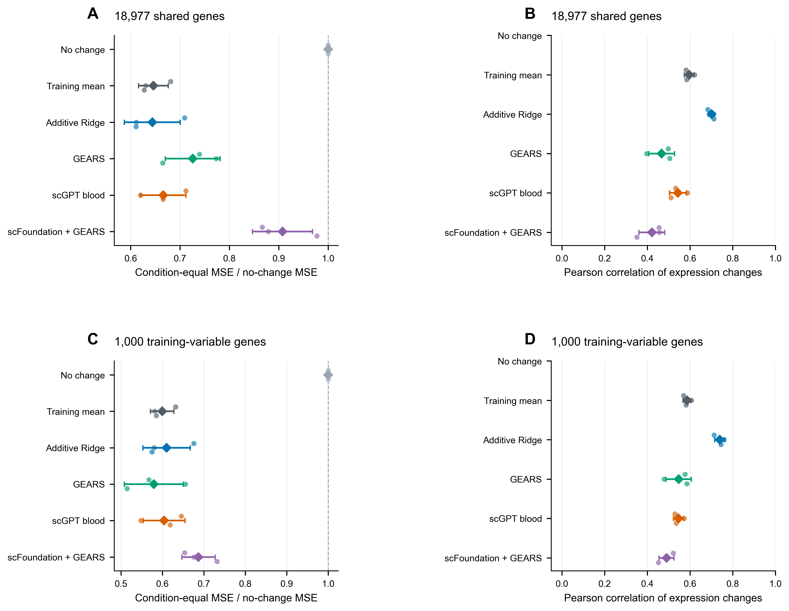
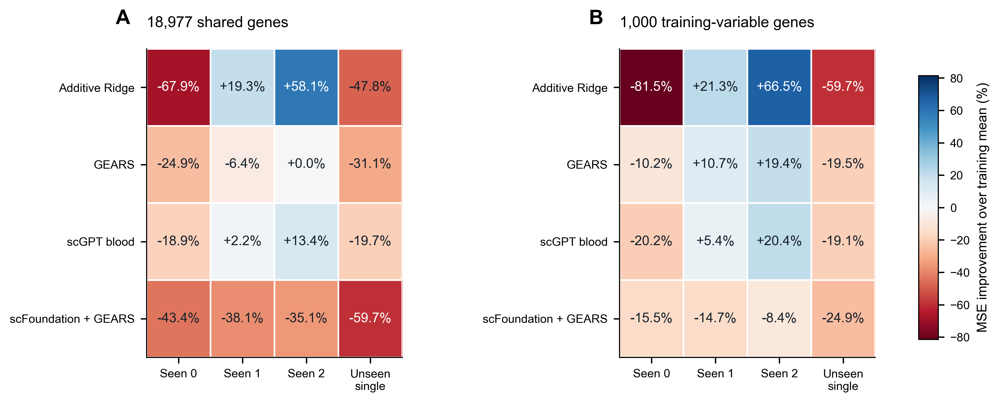
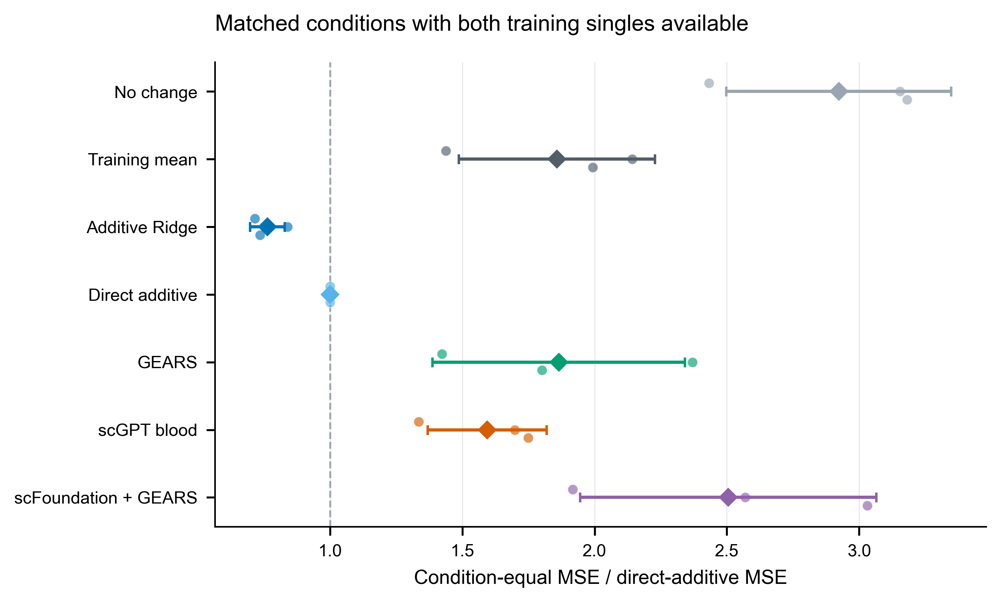
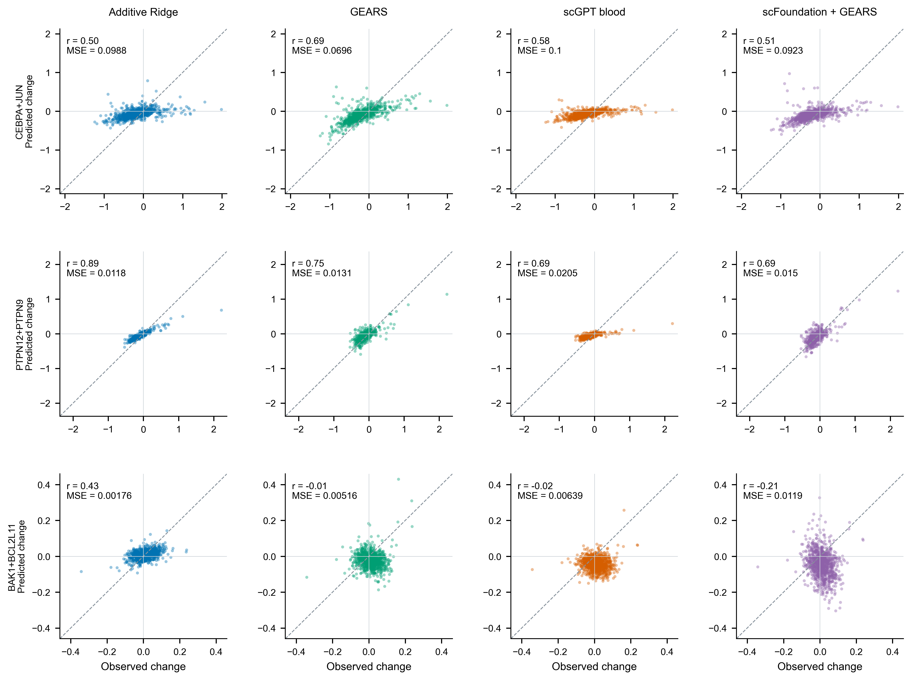
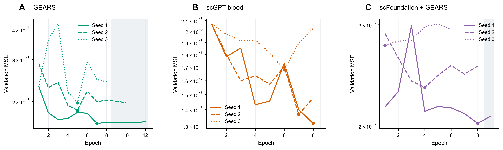

# 第 7 步：外部扰动响应预测结果

## 核心发现

在全部 18,977 个共同基因上，Ridge 加和 的三划分平均 MSE 最低，为 0.001970；相对零变化基线平均降低 35.6%。在训练集前 1,000 个高变基因上，最低平均 MSE 来自 GEARS（0.01974）。

Ridge加和与训练条件均值的整体MSE接近（0.001970与0.001973）；表达变化Pearson相关分别为0.701和0.596。三个GPU模型中，scGPT blood的共同基因平均MSE最低。

| 方法 | 共同基因 MSE（均值±SD） | 变化 Pearson r | HVG1000 MSE | 相对零变化 MSE 改善 |
|---|---:|---:|---:|---:|
| 零变化 | 0.003044 ± 0.000264 | — | 0.03412 | 0.0% |
| 训练条件均值 | 0.001973 ± 0.000265 | 0.596 | 0.02051 | 35.4% |
| Ridge 加和 | 0.001970 ± 0.000347 | 0.701 | 0.02091 | 35.6% |
| GEARS | 0.002214 ± 0.000302 | 0.467 | 0.01974 | 27.4% |
| scGPT blood | 0.002033 ± 0.000299 | 0.544 | 0.02068 | 33.4% |
| scFoundation＋GEARS | 0.002755 ± 0.000143 | 0.422 | 0.02340 | 9.2% |

结果先在各划分内按条件等权汇总，再对种子1、2、3取均值；SD描述三个划分之间的变化。零变化预测的变化相关系数无定义，以“—”表示。完整逐条件、逐划分及各基因集合结果均保存在[条件指标](../tables/07_condition_metrics.csv)、[划分指标](../tables/07_seed_metrics.csv)与[模型汇总](../tables/07_model_summary.csv)。

**图 1｜完整测试集比较。** 小点为三个划分，菱形及横线为均值±SD；MSE比值越低越好，表达变化相关越高越好。上、下分别使用全部共同基因及训练集高变基因。

## 数据、任务与训练设置

Norman2019 K562 CRISPRa 数据统一为84,143个细胞、225个条件（含对照）、100个扰动基因。输入表达保留公开处理矩阵的log1p尺度，原始总计数单独保留。模型共同评价18,977个基因，scFoundation使用完整19,264基因输入；各适配器、来源和权重校验见[第6步来源说明](06_pretraining_audit.md)。

三个种子沿用固定GEARS simulation清单，同一条件的所有细胞进入同一集合。每个训练集合中的全部细胞参与训练；64个固定训练对照作为各模型共享的参考输入，推断取64个预测的平均，真实响应取该扰动条件的全部细胞均值。表达变化均相对全部训练对照的均值计算。训练高变基因、共表达图及损失非零读出掩码分别由相应训练数据确定。GO图使用声明的100个扰动基因范围。

GEARS采用隐藏维数64；scFoundation＋GEARS采用官方v1模式、隐藏维数512及冻结编码器；scGPT加载blood通用预训练编码器，训练每批抽取1536个基因并保留直接扰动基因，推断覆盖全部共同输出基因。三个模型均使用原项目模型类。冻结编码器的64个对照表示以float32缓存，并与实时编码输出核对。

GEARS/scFoundation使用Adam，初始学习率0.001、权重衰减0.0005，逐轮乘0.5，梯度值裁剪1；scGPT使用Adam，初始学习率0.0001、逐轮乘0.9，梯度范数裁剪1。训练batch分别为64、24、64；浮点矩阵运算使用TF32，scGPT另采用bfloat16自动混合精度。等价的批量GEARS损失通过原实现的损失值和梯度比较。各模型根据验证条件等权MSE选最佳检查点，patience5。用户在运行中将训练上限收紧至8轮，全部最终检查点均从前8轮选出；调整前已完成的额外轮次保留在训练历史中。测试集在选定模型后评价。

Ridge以训练条件的二元扰动编码拟合表达变化，无截距；9个惩罚强度由验证集选择。训练均值按扰动条件等权，零变化返回训练对照均值。单扰动直接加和在两个单扰动均为训练条件时使用，另列其覆盖子集。正式配置见[stage7_config.json](../config/stage7_config.json)。

## 未见扰动的分层结果

**图 2｜最终训练集覆盖分层。** seen0/1/2表示组合中有0/1/2个扰动基因出现在最终训练条件中，另列未见单扰动。图中百分比为相对训练条件均值基线的MSE改善，正值表示误差降低。完整官方原标签与重新计算标签均保留。

按细胞划分的预测通常容易混入相同扰动条件；本实验将整个扰动条件留出，直接检验新条件的泛化。Ridge对训练中完全未出现的基因，其对应系数为零；训练均值基线提供跨条件共享响应，图结构与预训练表示则提供不同的迁移来源。分层表因此同时反映训练覆盖及模型表示的作用。

训练覆盖进一步区分了方法的适用条件：两个基因均已出现在训练条件中的组合，Ridge加和相对训练均值的MSE平均降低58.1%；两个基因均未出现的组合中，训练条件均值的平均MSE最低。这将后续模型研究具体指向新基因干预的响应幅度与特异性。

## 直接加和、读出敏感性与案例

三个划分分别有10、16、14个测试条件具备完整单扰动训练信息。在相同覆盖子集上，直接加和基线的共同基因平均MSE为0.00109。所有方法均在这组匹配条件上重新计算，见下图及完整表中的 `direct_additive_eligible` 分层。

**图 3｜完整单扰动信息下的组合预测。** MSE以同一划分的直接加和基线归一化；所有方法共享可用条件子集。

剔除直接扰动基因后，共同基因平均MSE分别为：零变化 0.00300；训练条件均值 0.00193；Ridge 加和 0.00195；GEARS 0.00218；scGPT blood 0.00202；scFoundation＋GEARS 0.00272。该补充结果集中考察更广泛的下游表达响应；高变基因对应结果也完整保存。

**图 4｜按真实响应强度选择的代表案例。** 从种子1的测试组合中，按训练高变基因上的真实响应均方幅度选择最大、中位和最小案例。每点为一个高变基因，虚线为一致线，案例选择未使用模型误差。

## 训练过程、资源与核心补充

**图 5｜验证误差与模型选择。** 线型表示三个划分，圆点为最低验证误差轮次，纵轴对数刻度。

| 模型 | 划分 | 完成轮次 | 最佳轮次 | 总耗时（分钟） | 最终进程峰值显存（GiB） |
|---|---:|---:|---:|---:|---:|
| GEARS | 1 | 12 | 7 | 20.1 | 6.09 |
| GEARS | 2 | 10 | 5 | 17.4 | 6.09 |
| GEARS | 3 | 8 | 5 | 13.9 | 6.09 |
| scGPT blood | 1 | 8 | 8 | 90.9 | 5.31 |
| scGPT blood | 2 | 8 | 7 | 94.2 | 5.31 |
| scGPT blood | 3 | 8 | 6 | 89.4 | 15.88 |
| scFoundation＋GEARS | 1 | 9 | 8 | 72.5 | 7.80 |
| scFoundation＋GEARS | 2 | 8 | 4 | 60.9 | 7.80 |
| scFoundation＋GEARS | 3 | 6 | 1 | 45.5 | 20.73 |

耗时累计预算切换前后的运行时间。显存列记录任务最终进程的分配峰值；续跑项的该进程包含检查点恢复和最终预测。

按原计划补充每目标 20 次重新调参子抽样：每次抽取 80% 基因，并重新进行三折正则化选择。原前 10 候选共 40 项的最低重新选择频率为 90%，其中 40/40 项的系数中位数方向与原全数据系数一致。完整结果见[重新调参候选表](../tables/07_core_top10_retuning_check.csv)。

## 与核心候选衔接：PRDM1

核心分析的稳定TF与Norman扰动目标共有5个规范身份：EGR1、OSR2、PRDM1、HNF4A和ZBTB25，对应8个细胞类型—候选条目。PRDM1在单核细胞分析中为100%重复选择的正向候选；在外部数据种子1中，PRDM1单扰动和CBFA2T3＋PRDM1组合均留作测试，分别属于未见单扰动和seen0组合。这个依据候选身份选择的案例，具体检验同一候选在K562新干预条件下的响应预测；其与单核细胞机制的联系继续由各自细胞背景的证据支撑。

| 方法 | PRDM1 单扰动 MSE | 变化 Pearson r |
|---|---:|---:|
| 零变化 | 0.04378 | — |
| 训练条件均值 | 0.02107 | 0.801 |
| Ridge 加和 | 0.04378 | — |
| GEARS | 0.02046 | 0.821 |
| scGPT blood | 0.03121 | 0.615 |
| scFoundation＋GEARS | 0.01710 | 0.751 |

在这一预先确定的PRDM1单扰动案例中，scFoundation＋GEARS的MSE最低（0.01710），GEARS的表达变化Pearson相关最高（0.821）。候选层面的比较由此补充了全体条件的平均表现，为后续同一候选的跨背景研究提供具体读出。

此表采用种子1训练集确定的1,000个高变基因。两个PRDM1相关条件的完整指标见[案例源表](../tables/08_PRDM1_response_bridge.csv)，共有候选的原始统计量见[候选交集](../tables/08_core_Norman_target_overlap.csv)。

## 研究解释与适用范围

表达状态预训练提供了可迁移的基因与细胞表示；扰动预测还需要把干预身份、细胞背景和响应幅度连接起来。本次比较把共享响应、加和响应、基因关系图和通用预训练放在相同条件划分下评价。简单基线的作用是刻画哪些结构已能由训练数据直接估计，从而定位复杂模型新增的信息。[GEARS原文](https://doi.org/10.1038/s41587-023-01905-6)、[scGPT原文](https://doi.org/10.1038/s41592-024-02201-0)、[scFoundation原文](https://doi.org/10.1038/s41592-024-02305-7)。

近期系统比较同样强调有力基线、匹配评价条件及干预特异性的重要性；其划分、基因集合和模型设置与本实验各自明确，结果可在研究问题层面相互参照。[Ahlmann-Eltze等，2025](https://doi.org/10.1038/s41592-025-02772-6)。

当前实验覆盖K562中的一个终点表达响应任务，三次划分描述这套数据内的变化。模型实现对应本次GO图范围、64个参考对照和已记录训练配置；本次采用8轮训练预算，比较结果也反映这一计算条件。通用预训练样本与Norman的逐细胞重叠状态尚未核实。后续医学世界模型研究可在此基础上加入时间、组织环境和功能结局，并在新背景中检验预测和校准。基因编辑与递送研究则可进一步将干预方向、表达持续时间和靶细胞状态纳入响应预测。

## 验收和成果入口

共88项正式实验自检通过；20次重新调参补充的划分、参数选择和收敛证书全部通过。九个GPU正式运行、四种基线的三组结果、全部最佳检查点、逐条件预测及图表源数据均归档。完整日志见[工作日志](../WORK_LOG.md)，图注见[图注文件](07_figure_captions.md)，最终归档见[第8步验收](08_archive_handoff.md)。
